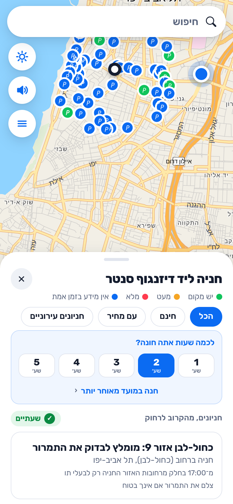
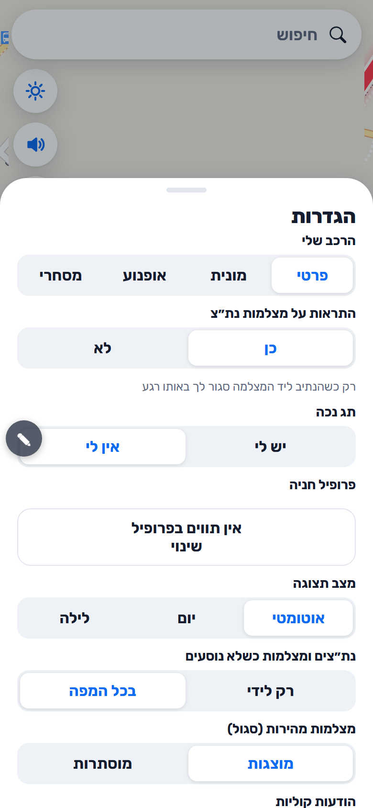
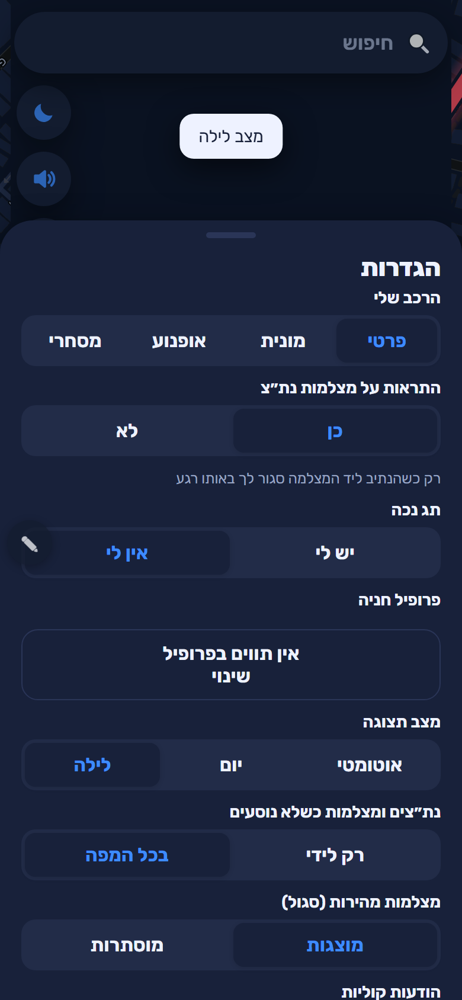
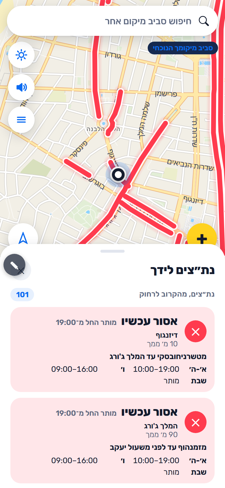
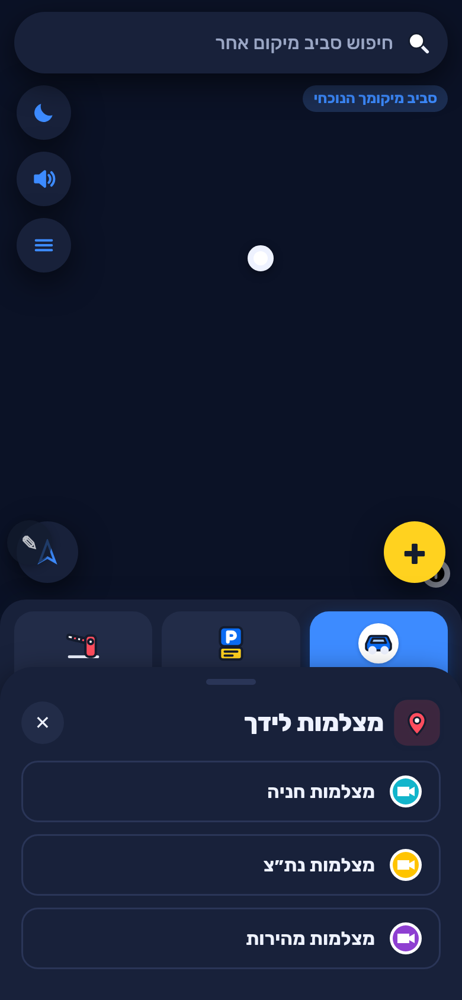
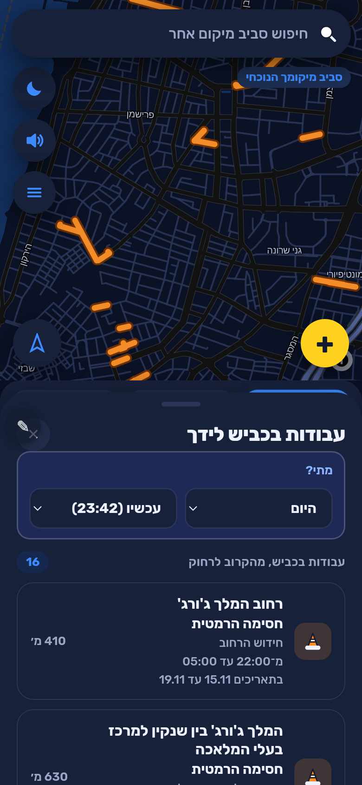
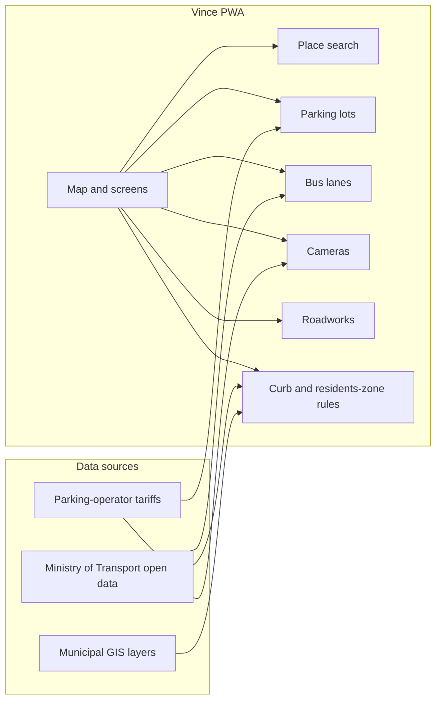

  

<h1 align="center">Vince</h1>

<strong>A free Israeli parking and driving assistant.</strong>

  Can I park here? What will the lot cost? Is this bus lane allowed right now? 
  Vince answers before you have to hunt for the sign.

  <a href="https://hiivince.pages.dev"><strong>Live demo</strong></a>
  ·
  Hebrew RTL PWA
  ·
  Day and night themes

---

## The problem

Driving in Israel means a patchwork of curb rules, resident-permit zones, bus lanes, enforcement cameras, and parking-lot tariffs that change by the hour, the day, and the city. The official information is scattered across street signs, PDFs, municipal maps, and operator apps.

Vince brings that into one installable, Hebrew, right-to-left progressive web app. A driver can check the street they are on — or search around a destination — and get a clear, timely answer.

## Features

  
  
  

- **Parking search with lot prices** — search around a place, choose how long you will stay, and filter free, paid, or municipal lots.
- **Bus-lane and camera alerts** — see nearby bus lanes and parking, bus-lane, and speed cameras, including while driving, with optional voice alerts.
- **Roadworks** — check works around you or at a destination, by time of day.
- **Residents-zone and curb rules** — a rules engine for when on-street parking is restricted to permit holders, and when it is not.
- **Day and night themes** — a Hebrew RTL interface that works as a mobile-friendly PWA.

  
  
  

## Architecture and tech stack

The client is a vanilla JavaScript PWA (ES modules, Vite) with a MapLibre GL map and official RTL text support. It is hosted on Cloudflare Pages, with Cloudflare Workers for lightweight server-side features such as user reports.

**Stack:** JavaScript, Vite, MapLibre GL, PWA, Cloudflare Pages, Cloudflare Workers, Node.js test runner, Playwright visual tests.

## Data engineering

Vince is as much a data and rules project as it is a map UI:

- Integrates government open datasets, including Ministry of Transport bus-lane data.
- Incorporates municipal GIS layers and parking-operator tariffs.
- A rules engine turns those sources into a timely answer — by city, street, side, hour, and day of week.
- **900+ automated tests** cover answers, tariffs, and visual snapshots of key screens.
- Built with a structured, multi-agent, AI-assisted workflow: tests first, a shared task board, and isolated feature branches.

## Live demo

Try the app: **[https://hiivince.pages.dev](https://hiivince.pages.dev)**

## Source code

Source code is private; available on request for interview.

## Contact

- GitHub: [shanihadad55](https://github.com/shanihadad55)
- Email: shanihadad55@gmail.com
